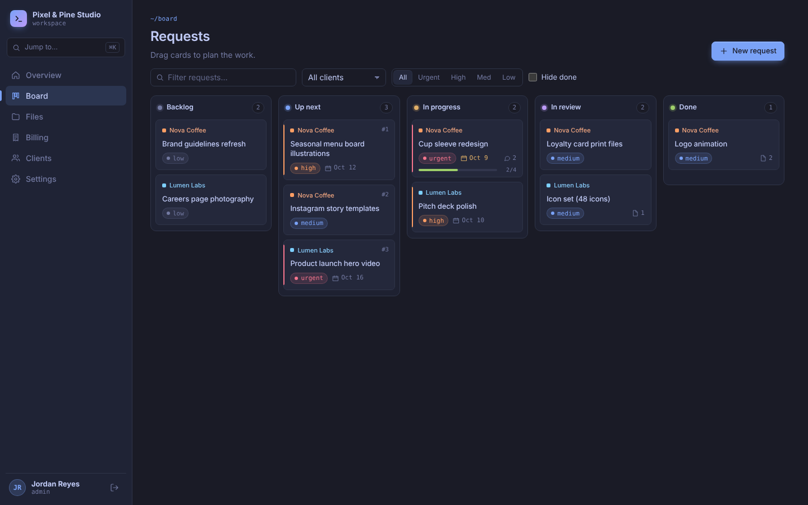
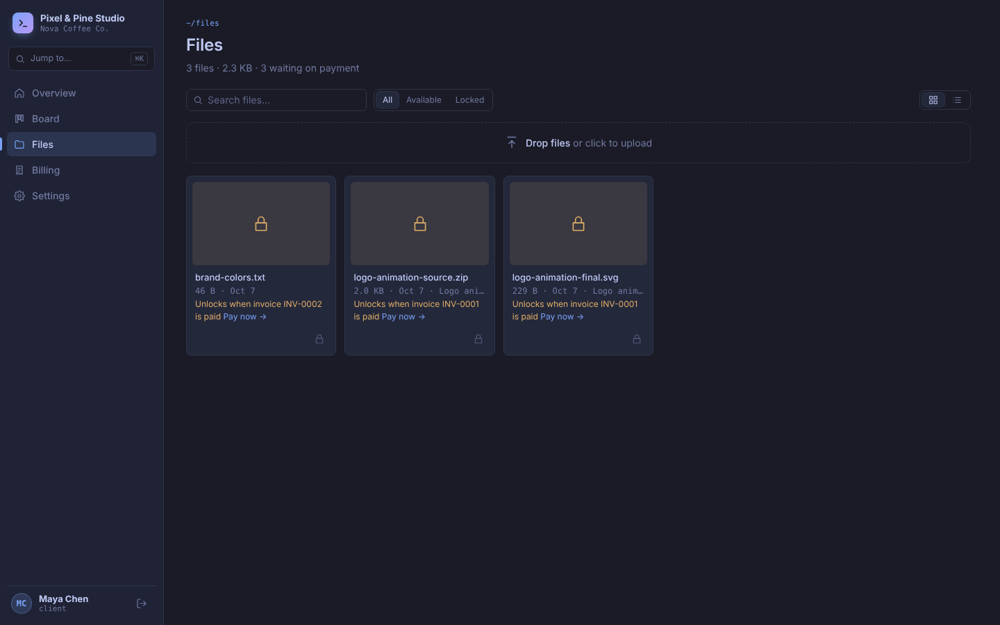
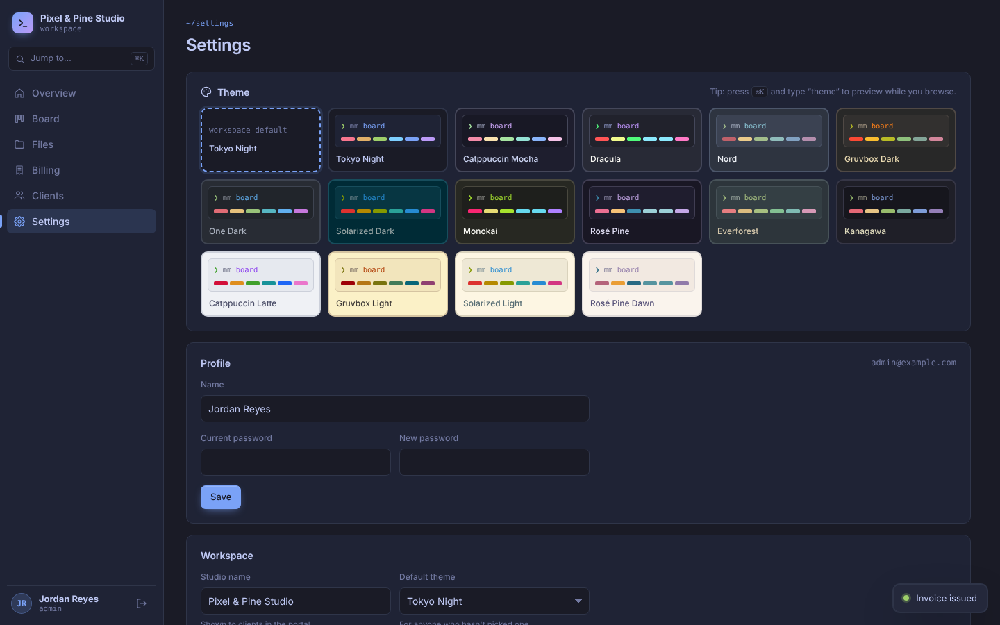
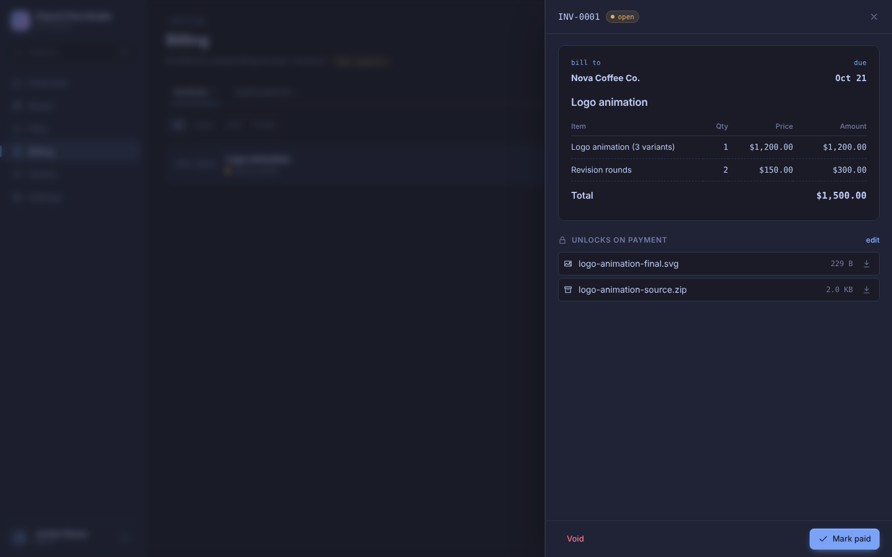
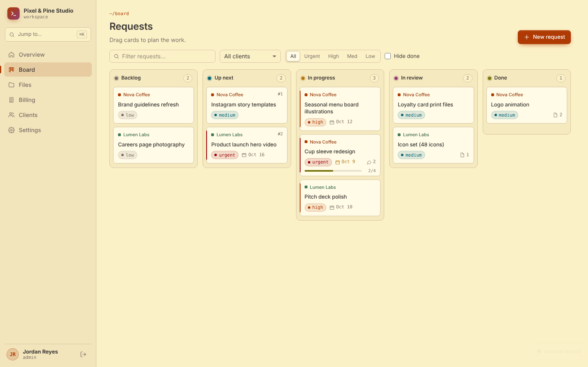

# Micro Manager

A small, self-hosted client portal and task manager for freelance creatives. Clients log in to submit requests, drag them into the order they care about, chat on each one, pay invoices, and download their files. You get a kanban board across every client, Stripe invoicing and subscriptions, and file delivery that unlocks when the bill is paid.

One Node process, one SQLite file, one uploads folder. No external services are required; Stripe is optional.



| Client files waiting on payment | Terminal themes |
| --- | --- |
|  |  |
| **Invoice with attached deliverables** | **Gruvbox Light** |
|  |  |

## Features

- **Kanban board** with five columns (Backlog, Up next, In progress, In review, Done). Clients see only their own requests and can drag to reorder them; the top of "Up next" is their highest priority. Mouse, touch and keyboard dragging are supported.
- **Requests** have a description, priority, due date, checklist, file attachments and a comment thread shared between you and the client.
- **Files** per client. Clients can browse, search, upload, rename and delete their own uploads, and download everything that is unlocked.
- **Paid-file gating.** Attach files to an invoice and they stay locked for the client until that invoice is paid. Files can also be marked "requires subscription". An active subscription unlocks every file on the account. Staff can always download.
- **Invoices** with line items, due dates and notes, sent through Stripe (hosted invoice page and email) or issued locally in demo mode. Mark paid for cash/bank transfers, void, and sync.
- **Subscriptions** (weekly, monthly, yearly retainers) that clients start through Stripe Checkout. Clients can manage cards or cancel via the Stripe customer portal.
- **15 terminal themes**: Tokyo Night, Catppuccin Mocha/Latte, Dracula, Nord, Gruvbox Dark/Light, One Dark, Solarized Dark/Light, Monokai, Rosé Pine/Dawn, Everforest and Kanagawa. Each person picks their own; admins set the default.
- **Command palette** (`⌘K` / `Ctrl+K`) to jump around and live-preview themes.
- Roles: **admin** (everything, plus team and workspace settings), **member** (manages clients, files and billing), **client** (their own portal).

## Quick start

### Docker

```bash
cp .env.example .env        # optional: add Stripe test keys, set APP_URL
docker compose up -d
open http://localhost:3000  # the first visit asks you to create the admin account
```

Data lives in the `micro-manager-data` volume (`/data` in the container): `micro-manager.db` plus an `uploads/` folder. Back up that folder and you have everything.

### Node (22.13+)

```bash
npm install
npm run build
npm start                   # http://localhost:3000
```

Want to look around first? `npm run seed` (after a build) fills an empty database with demo clients, requests, files and an invoice. Logins: `admin@example.com`, `client@example.com`, `lumen@example.com`, all with password `password123`.

## Configuration

| Variable | Default | |
| --- | --- | --- |
| `PORT` | `3000` | |
| `APP_URL` | `http://localhost:3000` | Public URL. Used in invite links and Stripe redirects. An `https://` URL turns on secure cookies. |
| `DATA_DIR` | `./data` | Database and uploads. |
| `MAX_UPLOAD_MB` | `200` | Per-file upload limit. |
| `ADMIN_EMAIL` / `ADMIN_PASSWORD` | | Creates the first admin on boot instead of using the setup screen. |
| `STRIPE_SECRET_KEY` | | `sk_test_…` while testing. Leave empty for demo billing. |
| `STRIPE_WEBHOOK_SECRET` | | `whsec_…`, optional (see below). |
| `DEMO_PAYMENTS` | `false` | Without Stripe, lets clients simulate payments. Testing only. |
| `CURRENCY` | `usd` | Currency for new invoices and subscriptions. |
| `TRUST_PROXY` | `loopback` | Express `trust proxy` setting when running behind a reverse proxy. |

## Stripe

1. Put a **test** secret key in `STRIPE_SECRET_KEY` and restart. Billing pages show a "stripe test mode" tag.
2. Create an invoice and choose **Create & send**. Micro Manager creates the customer, the invoice and its line items in Stripe, finalizes it and asks Stripe to email it. Clients pay on Stripe's hosted page.
3. Create a subscription. The client clicks **Start subscription** and pays through Stripe Checkout (or you copy the checkout link and send it).

Statuses are pulled from Stripe whenever someone opens Billing, so a self-hosted box that Stripe can't reach still stays correct. For instant updates, add a webhook endpoint at `APP_URL/api/stripe/webhook` listening to `invoice.*`, `customer.subscription.*` and `checkout.session.completed`, and set `STRIPE_WEBHOOK_SECRET`. Locally you can use the Stripe CLI:

```bash
stripe listen --forward-to localhost:3000/api/stripe/webhook
```

To let clients update their card or cancel, save a customer portal configuration once in the Stripe dashboard (Settings → Billing → Customer portal).

**Without Stripe**, issuing an invoice just marks it open and you record payments with **Mark paid**; subscriptions are activated by hand. To try the client side of the flow, set `DEMO_PAYMENTS=true` (it's on in `.env.example`): clients then get a "Pay" button that records a simulated payment. Turn it off before real clients log in, since it lets them mark their own invoices paid.

## How file locking works

For a client, a file is downloadable when any of these is true:

- they uploaded it themselves;
- their account has an active (or trialing) subscription;
- it is attached to at least one invoice and one of those invoices is paid;
- it is attached to no invoice and isn't marked "requires subscription".

Otherwise it shows as locked with the reason (for example "Unlocks when invoice INV-0004 is paid") and a link to pay. Downloads are checked on the server, so a locked file can't be fetched by URL.

## Development

```bash
npm install
npm run dev        # API on :3000 with reload, Vite on :5173 (open this one)
npm test           # API tests, including a faked Stripe flow
npm run typecheck
```

The stack is Express 5 + Node's built-in `node:sqlite` on the server and React 19 + Vite + dnd-kit on the client, all TypeScript. Themes live in `shared/themes.ts`; adding one is a single line.
